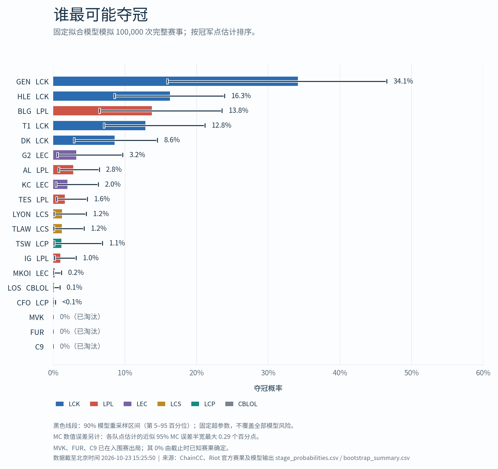
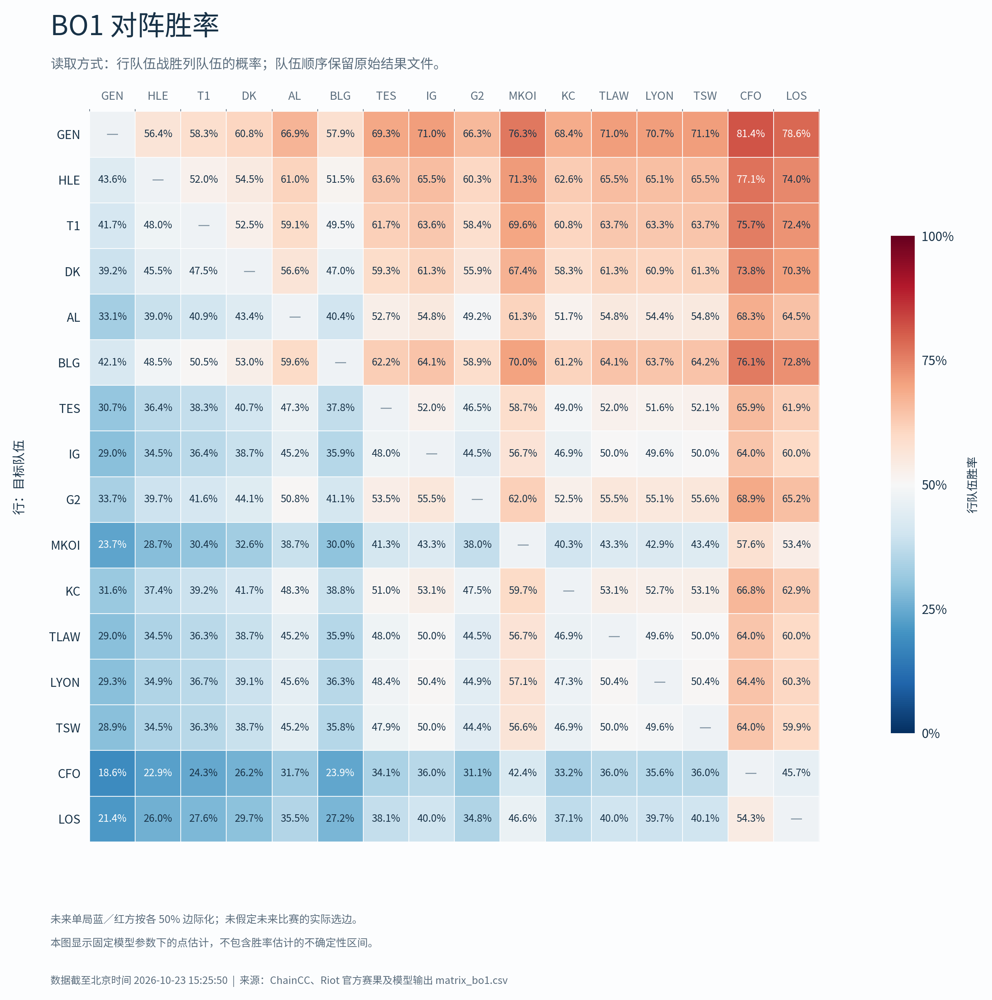

# Worlds 2026 Forecast · S16 夺冠模拟

用历史赛果估计战队实力，再模拟瑞士轮与淘汰赛，回答一个问题：**各支队伍有多大概率夺冠？**

Python 3.12 · Bradley–Terry · Monte Carlo · 可离线复现

[中文报告](docs/worlds2026_report.pdf) · [完整方法说明](docs/methodology.md) · [全部概率](outputs/stage_probabilities.csv) · [数据来源](evidence/history_sources.md) · [版本记录](CHANGELOG.md) · [网站与自动更新](docs/website.md)

> **冻结预测 v1.0.0**：信息截止为北京时间 **2026 年 10 月 23 日 15:25:50**。这是该时点的模型估计，不是实时榜单，也不是确定的比赛结果。本项目为个人分析，与 Riot Games 无隶属或背书关系。

## 结果预览



| 战队 | 八强 | 四强 | 决赛 | 夺冠 |
|---|---:|---:|---:|---:|
| GEN | 86.8% | 66.4% | 48.5% | 34.1% |
| HLE | 76.8% | 50.3% | 29.9% | 16.3% |
| BLG | 75.6% | 47.3% | 26.8% | 13.8% |
| T1 | 74.8% | 46.1% | 25.6% | 12.8% |
| DK | 67.4% | 38.0% | 19.2% | 8.6% |
| G2 | 52.5% | 23.4% | 9.2% | 3.2% |
| AL | 52.3% | 22.7% | 8.6% | 2.8% |
| KC | 48.0% | 19.3% | 6.7% | 2.0% |

以上来自已保存的 **100,000 次基线完整赛事模拟**，按夺冠概率排序。完整 CSV 包含 19 支队伍；截止时已淘汰的队伍，后续阶段概率为 0。

GEN 的基线夺冠概率约为 **34.1%**，90% 模型重采样区间为 **15.9%–46.6%**。这个区间反映模型重采样差异，不能覆盖全部模型风险。重采样中排名第一的频率也不等于夺冠概率。

## 这个项目做了什么

- **历史数据建模**：主样本包含 2,599 个比赛结果、1,005 个系列赛、61 支队伍；使用时间衰减和 L2 正则的 Bradley–Terry 模型。
- **时间回测**：5–7 月选参，8 月至截止时点留出测试，并与基础 Elo、恒定 50% 基线比较。
- **完整赛程模拟**：固定已知首轮，处理瑞士轮战绩分组、避免重复交手、BO1/BO3 切换与 BO5 淘汰赛。
- **不确定性分析**：15 组各 100,000 次敏感性模拟，以及 200 次重拟合 × 10,000 次赛事模拟；另附两组阵容减权情景。
- **可审计输出**：保留输入快照、来源、校验记录、随机种子、结果表和 SHA-256 清单。

上述主要生产日志合计记录 360 万次完整赛事模拟；不是 360 万次独立参数拟合。

## HTML 预览

[点击下载 HTML 预览文件](site/forecast.html?raw=true)

## 快速开始

只看结论可直接阅读 [PDF 报告](docs/worlds2026_report.pdf)，无需安装 Python。

运行代码请先下载或克隆本仓库，并进入项目根目录。推荐 Python 3.12：

```bash
python3 -m venv .venv
source .venv/bin/activate
python -m pip install -r requirements.txt
python src/check_repository.py
```

Windows 的虚拟环境激活命令为 `.venv\Scripts\activate`。

`check_repository.py` 会扫描常见凭据格式和本地绝对路径，并核对发布文件哈希，在临时副本中执行现有结果校验和小规模赛中更新演示；不会改写仓库里的冻结输出。GitHub Actions 也运行相同检查。

### 完整复现

```bash
python src/run_analysis.py --phase all
python src/verify_outputs.py
python src/build_figures.py
python src/build_report.py
```

完整运行包含数百万次模拟，耗时取决于机器性能，并会覆盖当前目录中的输出。建议在单独的克隆或副本中运行。该流程使用本地冻结输入，**无需联网或 API 密钥**；首次安装依赖需要网络。

也可分别运行 `--phase fit`、`--phase simulate`、`--phase uncertainty`。固定依赖、数据和随机种子支持复现；不同平台的浮点优化可能存在微小差异。原始运行环境见 [environment.json](outputs/environment.json)。

### 更新比赛状态

操作步骤、字段说明和限制见 [完整方法说明中的更新流程](docs/methodology.md#比赛结束后更新)。先保存旧版本，再更新信息截止、已知赛果和抽签状态，并记录变更。只更新赛果而未重新拟合时，应说明仍使用旧模型实力。

冻结数据处理、建模、模拟和报告构建继续支持离线运行。新增自动赛果更新器只读取有 CC BY 4.0 许可的 ChainCC 公开 CSV，不使用 Riot API 密钥。更新模型训练数据仍须单独审核并发布新版本。

## 项目结构

```text
.
├── src/                  # 数据清洗、模型、模拟器、验证及图表/报告构建
├── data/                 # 冻结数据、赛制、名单及已知比赛状态
├── outputs/              # 概率、矩阵、回测、敏感性及运行记录
├── figures/              # 可直接查看的 PNG/PDF 图表及字体
├── docs/                 # 中文报告与详细方法
├── evidence/             # 来源、官方赛程快照及核验说明
├── examples/             # 明确标注的合成状态更新演示
├── .github/workflows/    # 自动完整性与运行校验
├── config.json           # 信息截止、模型参数网格及随机种子
├── requirements.txt      # 固定依赖版本
└── MANIFEST.json          # 发布文件 SHA-256 清单
```

<details>
<summary>查看 16 队 BO1 对阵概率矩阵</summary>



</details>

## 如何理解这些概率

模型没有显式估计 BP、版本适应、选手状态或心理因素；跨赛区样本有限。BO3/BO5 基线假设固定实力下各局独立。抽签逻辑是对公开规则的一种可审计实现，并非官方内部算法。

回测衡量历史逐局预测表现，不能直接验证单届世界赛的夺冠概率是否校准。模拟次数更多能降低随机计算误差，不能消除模型偏差。详细假设和限制均保留在 [方法说明](docs/methodology.md)。

## 数据、署名与使用范围

比赛数据来自 **[ChainCC](https://chaincc.lol/free/data/)**，随原项目记录的许可为 **CC BY 4.0**；清洗、筛选和衍生字段的处理见 [来源说明](evidence/history_sources.md)。官方赛制及赛程资料另有逐项来源记录。字体保留各自许可。

完整第三方说明见 [THIRD_PARTY_NOTICES.md](THIRD_PARTY_NOTICES.md)。当前尚未为原创代码和报告指定开源许可证；公开可见不等于已授予任意再分发许可。

欢迎通过 Issue 反馈可复现的问题或方法建议。提交修改前请阅读 [贡献说明](CONTRIBUTING.md)，尤其不要用后续赛果覆盖历史预测。
